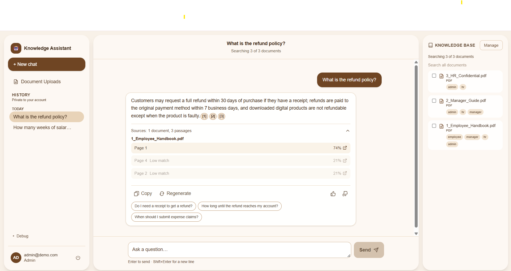
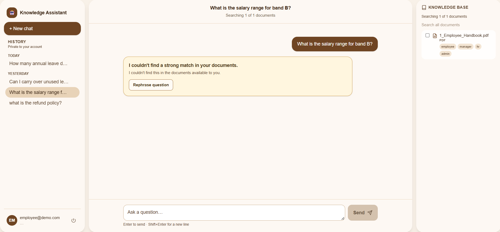
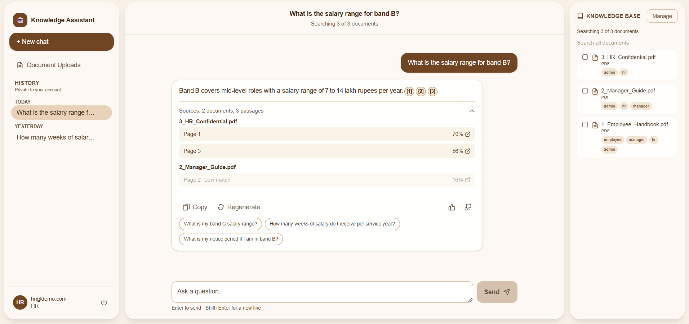
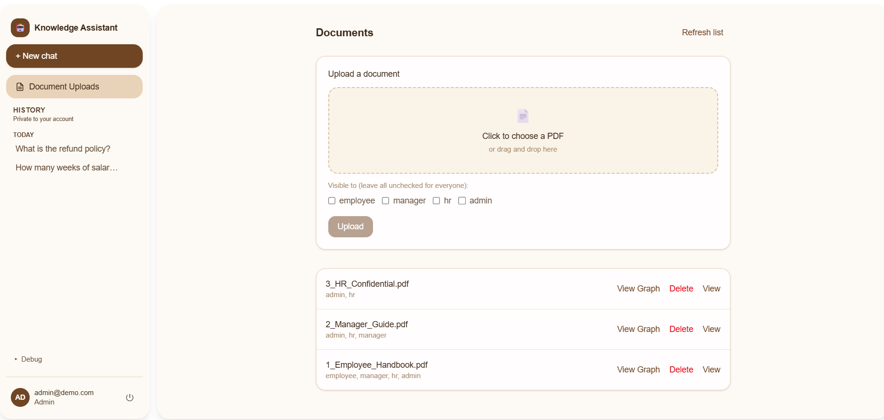
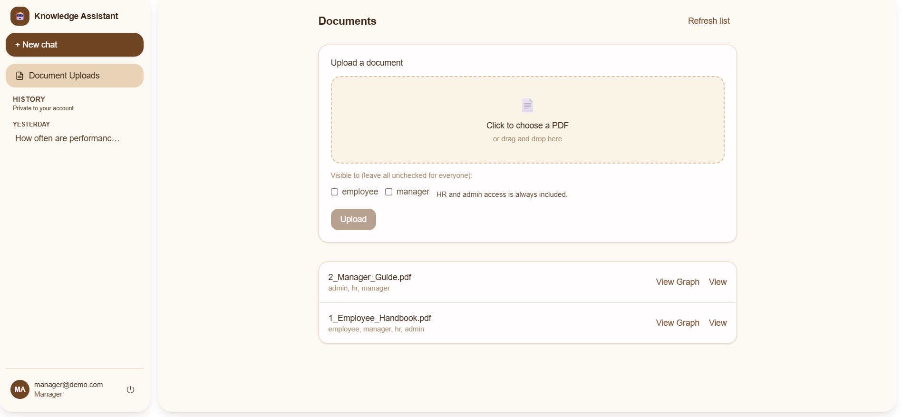
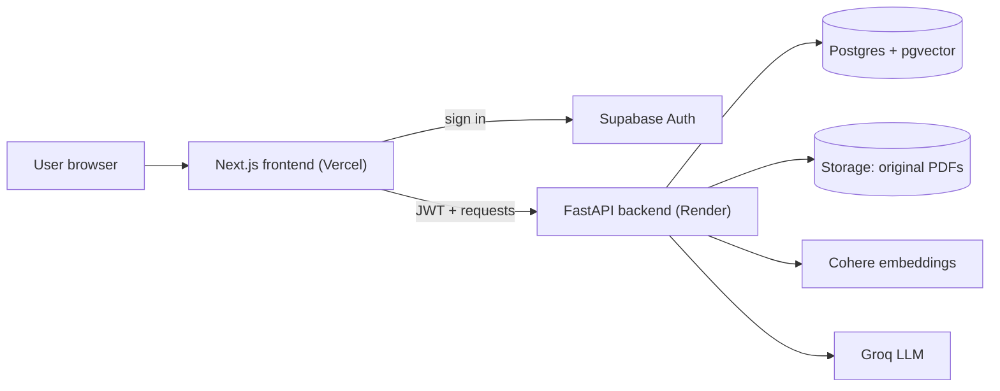

# Enterprise RAG Assistant

A role-based knowledge assistant for companies. Staff upload internal PDFs, and employees ask questions in plain English. Every answer is built **only from documents the signed-in user is allowed to see**, and cites the exact document and page it came from. When the documents don't contain a good answer, the assistant says so instead of guessing.

**Live demo:** https://enterprise-rag-assistant-xi.vercel.app

> The backend runs on a free Render instance, so the first request after a period of inactivity can take about a minute while it wakes up.



## Why this project

Company knowledge sits in PDFs, and generic chatbots can invent answers or leak confidential content. This project focuses on the two things that matter in an enterprise setting:

1. **Trust**: every answer shows its sources, and weak matches are refused.
2. **Access control**: HR-only and manager-only documents never reach the language model for users who shouldn't see them.

## Features

- **Role-based access** for four roles (admin, HR, manager, employee), enforced on the server during retrieval, not only hidden in the interface
- **Cited answers** with inline `[1] [2]` chips, document names and page numbers
- **Low-confidence refusal**: if no strong match exists, the assistant declines instead of guessing
- **Hybrid retrieval**: vector search (pgvector) combined with keyword search and re-scoring
- **Follow-up suggestions** generated from the stored passages and checked against the user's accessible documents, so every chip is answerable
- **Semantic cache scoped by tenant and role**, so a cached answer is never served to a user of a different role
- **Document management**: upload, delete and change access, with permission rules per role
- **Audit log** of uploads, deletions and access changes
- **Rate limiting** on uploads and questions
- **Multi-tenant data model** (every record belongs to a tenant)
- **Experimental**: entity and relation extraction per document (graph view is a work in progress)

## Screenshots

| Employee: restricted view and refusal | HR: access to confidential content |
|---|---|
|  |  |

| Document management | Manager upload limits |
|---|---|
|  |  |

## Roles and permissions

| Role | Can ask questions about | Can upload | Can delete or change access |
|---|---|---|---|
| Employee | Employee-level documents | No | No |
| Manager | Employee and manager documents | Yes, shared with employee and/or manager only | Only their own uploads |
| HR | Employee, manager and HR documents | Yes | All documents |
| Admin | Everything | Yes | All documents |

A user can never share a document with a level above what they can read. HR and admin access is always added automatically.

## Architecture



**Ingestion (when a document is uploaded)**

1. Check the uploader's role and the roles they chose to share with
2. Extract text page by page with PyMuPDF, keeping page numbers
3. Split into overlapping, sentence-aware chunks
4. Embed each chunk and generate suggested questions it can answer
5. Store chunks, vectors, page numbers, role tags and suggested questions; keep the original PDF in storage

**Question answering**

1. Look up which documents the user's role may read
2. Embed the question, then run vector search and keyword search over only those documents
3. Merge and re-score the results; refuse if the best match is below the confidence threshold
4. Ask the LLM to answer using only the retrieved passages
5. Return the answer with citations, then store it in the role-scoped cache

## Tech stack

| Layer | Technology |
|---|---|
| Frontend | Next.js, React, TypeScript |
| Backend | FastAPI (Python 3.13) |
| Database, auth, storage | Supabase (Postgres, pgvector, Auth, Storage) |
| Embeddings | Cohere |
| LLM | Groq |
| PDF parsing | PyMuPDF |
| Hosting | Vercel (frontend), Render (backend) |

## Security notes

- Retrieval is filtered by role before any passage is sent to the language model
- Upload, delete and access-change endpoints check the caller's role on the server
- Cached answers are keyed by tenant and role
- Secrets live only in environment variables; `.env` files are git-ignored and only `.env.example` templates are committed
- The Supabase service key is used only by the backend
- Row-level security is enabled on every table, with no direct-access policies, so only the backend can read data
- The PDF storage bucket is private; files are served through short-lived signed links
- Search functions run with the caller's rights, so database rules still apply to them
- Uploads are limited to PDFs up to 20 MB, and uploads and questions are rate limited per user
- Public sign-ups are disabled on the demo deployment

## Evaluation

A script (`backend/scripts/evaluate.py`) signs in as each demo role and asks 31 questions through the chat API. Latest run:

| Check | Result |
|---|---|
| Answer accuracy (right fact in the answer) | 17 / 17 |
| Access control (no restricted content in any response) | 10 / 10 |
| Unanswerable questions refused | 4 / 4 |

Per-question results are in [`docs/evaluation_results.md`](docs/evaluation_results.md). The test set is small and uses the demo documents in this repository, so treat it as a regression check, not a benchmark.

## Run it locally

**Prerequisites:** Python 3.13, Node.js 20+, a Supabase project, and API keys for Cohere and Groq.

```bash
git clone https://github.com/vaishali16-maker/Enterprise-RAG-Assistant.git
cd Enterprise-RAG-Assistant
```

**Backend** (run from the repository root)

```bash
python -m venv .venv
.venv\Scripts\activate          # macOS/Linux: source .venv/bin/activate
pip install -r backend/requirements.txt
copy backend\.env.example backend\.env      # then fill in your values
uvicorn backend.main:app --reload --port 8000
```

**Frontend**

```bash
cd frontend
npm install
copy .env.example .env.local    # then fill in your values
npm run dev
```

Open http://localhost:3000.

**Database:** in a new Supabase project, open the SQL editor and run `backend/schema.sql` once. It creates the tables, indexes, search functions, security settings and the private `documents` storage bucket, and adds a trigger that gives every new user an employee profile in a "Demo Company" tenant. The files in `backend/migrations/` are the incremental history and are already included in `schema.sql`, so a new project does not need them.

Then create users in Supabase Auth and promote them by updating `profiles.role` (`employee`, `manager`, `hr` or `admin`). Put the id of the "Demo Company" row from the `tenants` table into `DEFAULT_TENANT_ID` (used by the command-line helper scripts).

**Tests**

```bash
pip install pytest
python -m pytest backend/tests -q
```

The suite has 14 backend tests covering upload permissions, ownership rules, file validation and rate limiting.

## Scope and limitations

- Works with text-based PDFs; scanned (image-only) files need an OCR step, which is on the roadmap
- The demo runs on free hosting, so the first request after a period of inactivity can take about a minute
- The evaluation set is small (31 questions on the demo documents): a regression check, not a benchmark
- The standalone `/ask`, `/ask/stream` and `/ask/agent` endpoints are role-scoped but do not yet apply the low-confidence refusal that the chat endpoint uses
- Rate limits are held in memory per instance, which suits a single server; a shared store would be the next step for scaling out
- Uploads are not wrapped in one database transaction, so a failure part-way through graph extraction or storage can leave a partial record
## Roadmap

- Larger evaluation set covering more document types and question styles
- Apply the same confidence check to every answer endpoint
- Admin dashboard (top questions, feedback ratio, unanswered questions)
- OCR for scanned PDFs
- One-command local setup (Docker)
- Cleaner knowledge-graph visualisation
